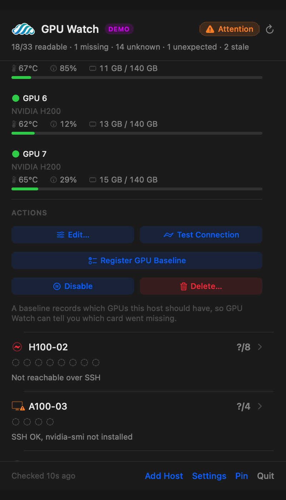
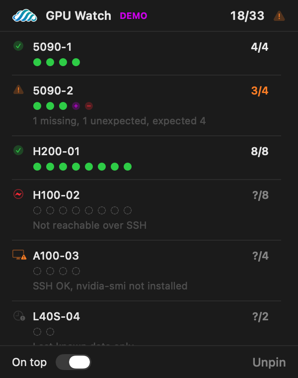
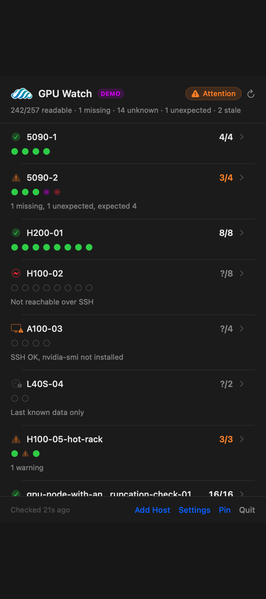
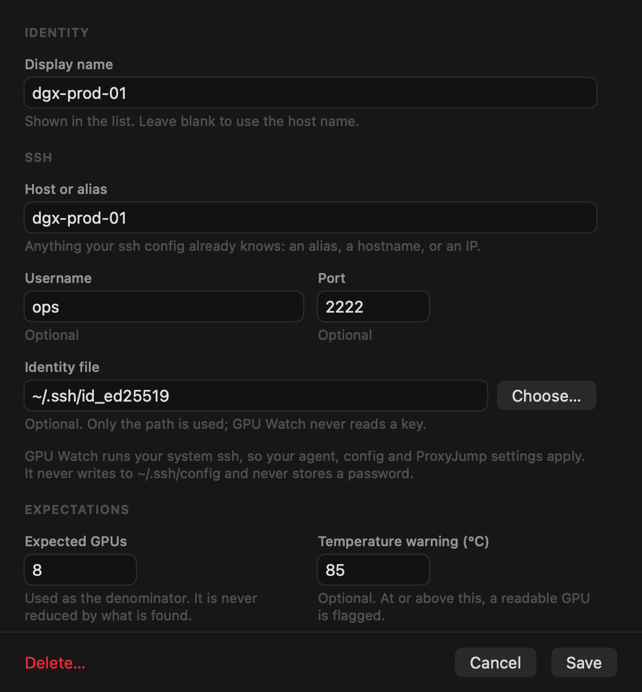
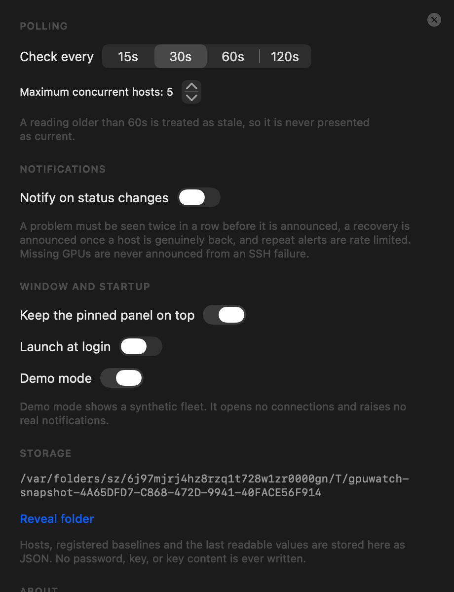

# GPU Watch

**A macOS menu bar monitor for NVIDIA GPUs on remote servers — over SSH, with nothing installed on the server.**

[](LICENSE)
[](#requirements)
[](https://swift.org)
[](#built-with-nothing)

<p align="center">
  
</p>

---

## The problem with most GPU monitors

They are optimistic.

When the SSH connection drops, a typical dashboard shows `0/8` in red. When the driver stops answering, it shows an empty list. When it has not polled in ten minutes, it shows the last values it had. In every one of those cases you are looking at a screen that **looks like a hardware failure but is actually a monitoring failure** — and the cost of that confusion is a 2 a.m. page for four cards that were never broken.

GPU Watch is built around one rule: **it would rather say "I don't know" than show you something it cannot support.**

## What that looks like in practice

<p align="center">
  
</p>

An unreachable host reads `?/8` with hollow dots — *eight slots, none confirmed* — not `0/8` in red, which reads as *eight dead GPUs*. The reason line says "Not reachable over SSH". Those are different facts and the app keeps them different.

| The rule | Why it matters |
|---|---|
| SSH reachability, GPU query status and data freshness are **three separate axes** | One transport hiccup must never be reported as a GPU failure |
| A failed connection marks every GPU **unknown** — never missing, never healthy | We cannot see the cards, so we have nothing to say about them |
| A GPU is called **missing only when a complete query positively lacked its baseline UUID** | Never infer absence from a partial read |
| Without a registered baseline, **no specific card is ever named as missing** | You cannot identify a card you have never fingerprinted |
| Counts carried forward from an earlier check are **never counted as readable** | A stale number must not inflate the total |
| `N/A` is never coerced to `0`, and empty or unparsable output is never healthy | "The driver did not answer" is not "the value is zero" |
| High utilisation and high VRAM are **not failures** | Working hard is not broken |
| A green dot means the driver **saw and answered for** that GPU — not that CUDA, NCCL or vLLM are ready | The boundary of the claim is stated in the tooltip, not implied |

## Screenshots

| Missing GPU, with baseline | Host actions | Pinned panel |
|---|---|---|
|  |  |  |

| Many hosts | Host editor | Settings |
|---|---|---|
|  |  |  |

## Requirements

- macOS 14 (Sonoma) or later. Apple Silicon and Intel.
- Xcode Command Line Tools. No Xcode project, no IDE, no code signing identity needed for a local build.
- On the servers: SSH, and `nvidia-smi` on the remote user's `PATH`.

**NVIDIA physical GPUs only.** MIG instances are partitions of one card and are deliberately not counted as additional GPUs. AMD is not supported and the app says so rather than guessing.

## Install

### Build from source

```bash
git clone https://github.com/Knoxpix/GPUWatch.git
cd GPUWatch
./Scripts/build-app.sh
open dist/GPUWatch.app
```

The app appears in the menu bar only — no Dock icon, no window in your way.

Builds are **ad-hoc signed** by default (`--sign -`), which is what a local build needs. Nothing in the build touches Gatekeeper or any security setting on your machine. To distribute a build to others, sign with a Developer ID and notarise:

```bash
SIGN_IDENTITY="Developer ID Application: …" ./Scripts/build-app.sh
xcrun notarytool submit dist/GPUWatch.app.zip --keychain-profile <profile> --wait
xcrun stapler staple dist/GPUWatch.app
```

There is no prebuilt binary in the repository. Building it yourself takes about a minute, and means you are running code you can read.

## Quick start

1. Launch the app. It appears in the menu bar showing `GPU Watch`.
2. Click **Add Host**, or click **Try Demo** to see the whole thing working against a synthetic seven-host fleet — including a missing GPU, a replaced card, an unreachable host and a stale reading — before you configure anything.
3. Fill in the SSH alias or hostname you already use. Your `~/.ssh/config`, your agent and your keys do all the work.
4. Press **Test Connection**. It reports by stage: *SSH failed* / *SSH OK, no nvidia-smi* / *SSH OK, GPU query failed* / *success with N GPUs*. "It didn't work" is not a useful answer.
5. Once it has read your GPUs, open the host and press **Register GPU Baseline**. That records which cards this machine should have, and from then on the app can tell you exactly which one went missing.

Demo mode opens no connections and raises no real notifications, and its data is kept entirely separate from your configuration.

## How it works

GPU Watch runs your **system `ssh`** — `/usr/bin/ssh`, invoked with an argument array and no shell, ever. That means:

- Your `~/.ssh/config`, `ProxyJump`, `Match` blocks, agent and certificates all apply.
- It stores the **path** to an identity file, never its contents. No password is ever stored.
- It never writes to `~/.ssh/config`, never accepts a new host key, and never edits `known_hosts` for you. An unknown or changed key is reported so you can verify it in Terminal yourself.

Every host gets one fixed remote script — a constant in the source, with nothing user-supplied interpolated into it:

```sh
nvidia-smi --query-gpu=index,uuid,name,temperature.gpu,utilization.gpu,memory.used,memory.total \
           --format=csv,noheader,nounits
```

The script is wrapped in markers and ends with `exit 0` **unconditionally**. That single detail is what makes the two axes separable: SSH succeeding while `nvidia-smi` fails is a completely different report from SSH failing, and the app can tell them apart instead of collapsing both into "host is down".

## Status model

Three axes, shown separately and never merged:

| Axis | Values |
|---|---|
| **SSH transport** | Connected · Unreachable · Auth failed · Host key · Timed out · Cancelled |
| **GPU query** | ok · No nvidia-smi · Query failed · Empty output · Unparsable |
| **Data freshness** | fresh · stale · unknown |

Per-host: Checking · Reachable · SSH failed · GPU query failed · Degraded · Stale · Disabled · Unknown.

Per-GPU, colour **and shape** — because a red/green distinction is invisible to a meaningful share of engineers:

| | Shape | Meaning |
|---|---|---|
| 🟢 | filled circle | The driver identified it and answered its core metrics in the latest check |
| 🟡 | triangle | Readable, but a warning: over your temperature threshold, or metrics the driver does not support |
| 🔴 | circle with a bar | **Confirmed absent** from a complete check |
| 🟣 | circle with a plus | Present but not in your baseline |
| ⚪ | dashed circle | Unconfirmed: unreachable, unqueryable, never checked, or stale |

Every dot has a tooltip and an accessibility label carrying the same information as the colour.

## Baseline and expected count

**UUID is the identity. Index is decoration** — it is reassigned after a reboot, so a monitor that tracks indices will invent a card failure every time you reboot.

The expected GPU count is *yours*. It never shrinks to match what was found: if a card fails, the baseline keeps its UUID so the app can keep telling you it is gone. Registering a baseline always shows you the UUIDs first. Replacing a card shows you both the UUID that is gone and the one that appeared, and you decide when to accept the new set.

## Configuration

| Setting | Default | Range |
|---|---|---|
| Poll interval | 30 s | 15 / 30 / 60 / 120 s |
| Concurrent checks | 5 hosts | 1–8 |
| Whole-check timeout | 12 s | fixed |
| Stale window | `max(2 × interval, 60 s)` | follows the interval |
| Notifications | off | opt-in |

Polling is built so that a burst of Refresh clicks cannot multiply the work: one check at a time per host, bounded concurrency across hosts, and a generation guard so a result that arrives after you edited or deleted a host is discarded rather than applied to the wrong configuration. Quitting ends any `ssh` still running. **Opening more windows never adds a second polling loop.**

After a sleep, everything is demoted to stale and re-checked immediately.

## Notifications

Off by default. Permission is requested only when you turn them on.

- A problem must be seen **twice in a row** before it is announced — a single failed poll is usually a hiccup, and an app that cries wolf gets ignored.
- Recoveries are announced, and go through the same confirmation, so a flapping host does not alternate banners.
- Repeat alerts are rate limited.
- **Missing GPUs are never announced from a transport failure.** That is enforced structurally: a failed transport produces `missing == 0`, so the alert cannot be constructed.

## Privacy

- No telemetry, no analytics, no network calls except `ssh` to the hosts you configured.
- No password, key, or key content is ever written.
- Everything lives in `~/Library/Application Support/GPUWatch/` (mode `0700`) as three JSON files with a schema version:

```
config.json        hosts and settings
baseline.json      the GPU baselines you accepted
last-known.json    last readable values, for showing "last known" after a restart
```

Writes are atomic. **A file that cannot be read is never overwritten** — it is preserved under a timestamped name and the failure is reported, together with a button to open the folder. A file written by a newer version is refused with an explanation rather than misread.

## Built with nothing

Swift and SwiftUI plus a thin layer of AppKit for the windows. **No third-party dependencies at all** — no Electron, no web view, no backend, no Docker.

```
GPUWatch.app/Contents/MacOS/GPUWatch    2.2 MB
GPUWatch.app (whole bundle)             2.7 MB
```

## Architecture

```
Sources/
├── GPUWatchCore/        no UI at all; testable without SSH
│   ├── Models/          HostConfig, GPUSample, Baseline, Status, HostReport, PollSettings
│   ├── SSH/             SSHTarget (validation), SSHProcessRunner, RemoteProbe,
│   │                    HostProbeRunner, SSHFailureClassifier, ConnectionTester
│   ├── Parsing/         CSVLine, GPUFieldValue, NVIDIAQueryParser
│   ├── Evaluation/      GPUStateEvaluator — every policy decision lives here
│   ├── Polling/         Clock, AppModel (the single source of truth)
│   ├── Store/           ConfigurationStore
│   ├── Notifications/   NotificationService, UserNotificationDeliverer
│   └── Demo/            DemoFixtures
├── GPUWatchUI/          SwiftUI + AppKit, as a library so the snapshot harness can
│                        render the real views rather than a reimplementation
├── GPUWatch/            entry point
└── GPUWatchSnapshot/    visual QA harness
```

The parser and the state evaluator take no SSH dependency, and the runner and the clock are protocols — so the interesting behaviour is testable without a server.

### A note on `MenuBarExtra`

This was originally built with SwiftUI's `MenuBarExtra` and moved to an explicit `NSStatusItem`. `MenuBarExtra` exposes no handle on the item: there is no way to tell whether it was installed, to open its popover programmatically, or to report its state when something hides it — and during development the item did not appear with no way to find out why. Owning the `NSStatusItem` means `--diagnose` can distinguish "not installed" from "installed but hidden", and `--show-popover` can open the real popover for inspection.

Related: on a multi-display Mac the menu bar item appears on **whichever display owns the menu bar**, which is not necessarily the main one.

## Testing

```bash
swift test                    # 148 tests
./Scripts/verify-ui.sh        # render every screen + report the menu bar item's position
```

Covered: quoted CSV fields · `N/A`, unsupported, malformed and empty output · identity surviving an index swap · a baseline GPU going missing · a replacement UUID appearing · expected-count mismatch · **SSH failure never becoming a missing GPU** · partial results never becoming missing · timeouts and cancellation · stale data · results arriving after an edit or delete · notification debounce, cooldown and recovery · corrupt configuration files · hosts loaded from disk actually completing their check · windows not being rebuilt under the user · every per-host action reaching the model.

### Visual QA

`Sources/GPUWatchSnapshot` renders the **real view types** into `dist/screenshots/` so the interface can be reviewed from images rather than by clicking through a menu bar item. It draws the view hierarchy into a bitmap itself rather than using `CGWindowListCreateImage`, which is deprecated, needs the screen-recording permission, and returned blank surfaces intermittently.

The app also carries three troubleshooting modes:

```bash
GPUWatch --diagnose                            # environment + where the menu bar item is
GPUWatch --check user@host --expected 8        # one real check through the app's own pipeline
GPUWatch --show-popover                        # open the real popover and stay open
```

## Limitations

Stated plainly, because a monitor that oversells itself is the problem this project exists to fix.

- **No process or MIG support.** A fixed field set only: no `--query-compute-apps`, no NVLink or ECC, and no history or graphs.
- **AMD is unsupported by design.**
- The **remote login shell must be POSIX** (`sh`, `bash`, `dash`, `zsh`). On `csh`/`tcsh` the markers never arrive and the app reports an unclassified SSH problem instead of pretending it succeeded.
- **Notifications are not verified end-to-end on a real machine.** The logic is unit tested, but the permission prompt and delivered banners have not been observed.
- Tested on **macOS 27.2.1 on Apple Silicon only**. Not yet exercised on macOS 14–26 or on Intel.
- **Not tested against a host with a genuinely failed GPU, a rotated host key, or a mix of GPU models.** Live verification was against reachable hosts with healthy cards.
- The Settings page does not show whether notification permission has been denied until you try to enable it.
- Scrolling and controls in the real windows are covered by tests rather than by screenshots: `screencapture` on the development machine began returning black images, so the final round of window verification is test-based.

## License

GPL-3.0-or-later. See [LICENSE](LICENSE).

Copyright © 2026 SIAM.AI Corporation.

GPL was chosen deliberately: anyone may use, study and modify this, but a distributed modified version must remain open. A monitoring tool that tells you the truth about your hardware is worth keeping verifiable.

The **SIAM.AI name and logo are trademarks of SIAM.AI Corporation** and are not covered by the GPL grant. If you fork this and distribute your own build, replace the brand mark — the code licence does not extend to the mark. The artwork lives in `Sources/GPUWatchUI/Resources/` and `Packaging/Brand/`.

---

[อ่านฉบับภาษาไทย →](README.th.md)
