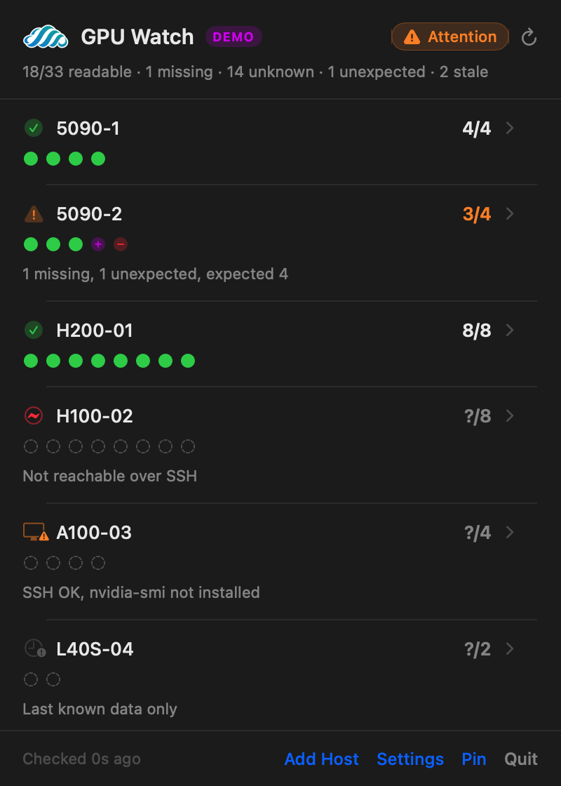
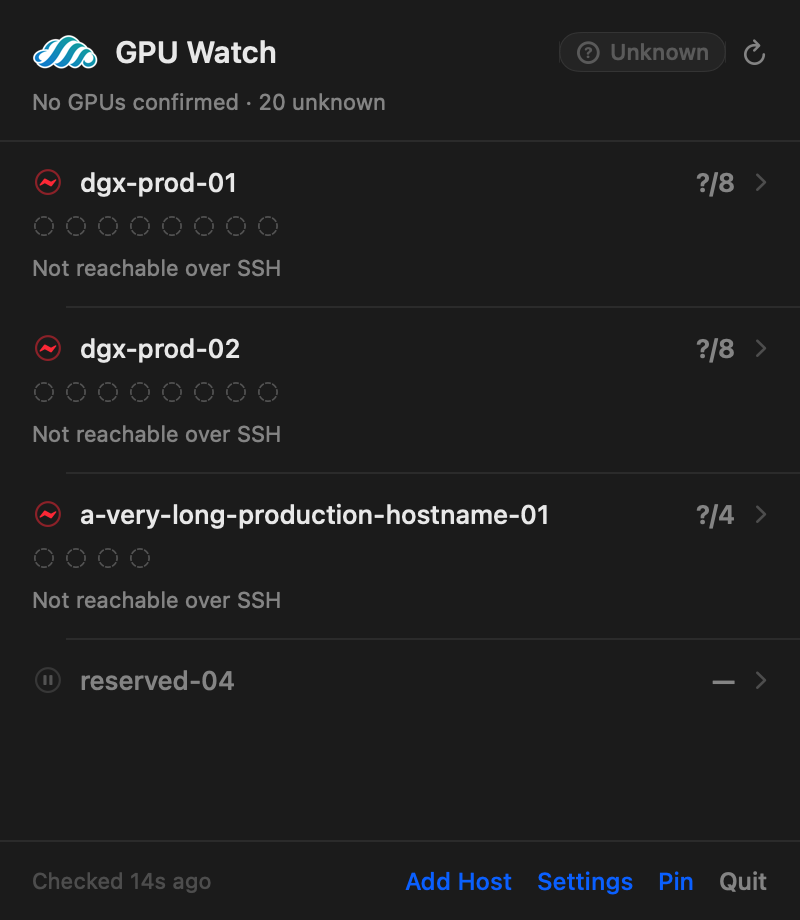
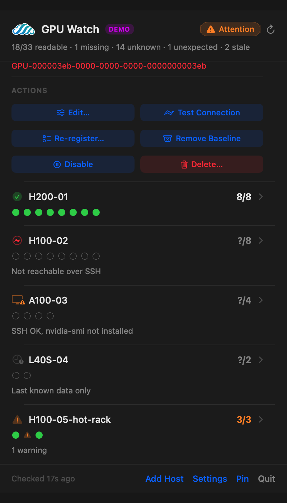

# SIAM.AI GPU Watch

A macOS menu bar app for monitoring NVIDIA and AMD GPUs across remote servers over SSH. View GPU counts, temperature, utilisation and memory usage for multiple hosts in one panel.

Uses the server's existing SSH service, with `nvidia-smi` for NVIDIA hosts and ROCm's `rocm-smi` for AMD ones; no additional monitoring agent is required.

[](LICENSE)
[](#requirements)
[](https://swift.org)

<p align="center">
  
</p>

## Features

- Check multiple hosts on a schedule or refresh manually.
- View each GPU's status, temperature, utilisation and VRAM usage.
- Read power and memory metrics where the driver supports them.
- Save GPU UUIDs as a baseline to identify missing or replacement cards.
- Pin the panel on screen and enable notifications.
- Try the interface with built-in demo data before connecting a server.

## Requirements

- macOS 14 (Sonoma) or later. The project targets Apple Silicon and Intel; see the testing limitations below.
- Xcode Command Line Tools to build from source.
- SSH access to each server, with that vendor's tool on the remote user's `PATH` — `nvidia-smi` for NVIDIA, `rocm-smi` for AMD.
- A remote login shell that supports POSIX syntax, such as `sh`, `bash`, `dash` or `zsh`.

Only physical GPUs are counted. NVIDIA MIG instances are partitions of one card and are not counted as additional cards. A host with neither tool is reported as having no GPU tool, which is a statement about its software rather than about its cards.

### Which vendor a host is read with

Hosts detect the vendor by default: `nvidia-smi` is used when it answers with real rows, otherwise ROCm. The order matters, because a machine that has moved from NVIDIA to AMD often still has `nvidia-smi` installed and answering with an error, and reporting that error would be true but useless. A host can also be pinned to NVIDIA or AMD in the host editor, for a machine carrying the previous vendor's tool on its `PATH`.

Both paths report the same readings, so thresholds, baselines and notifications do not need to know which vendor a host is. Differences in units are converted once, in the parser: ROCm reports VRAM in bytes, converted to MiB to match nvidia-smi.

One reading is not flattened, and the app does not pretend otherwise: **temperature**. ROCm's edge sensor matches nvidia-smi's `temperature.gpu` and is preferred. AMD's Instinct cards have no edge sensor at all — only junction (hotspot) and memory — so the junction reading is used there, and labelled `junction` wherever the number appears, including in a threshold warning.

## Install

Build from source. There is currently no prebuilt application download.

```bash
git clone https://github.com/siamaicorp/GPUWatch.git
cd GPUWatch
./Scripts/build-app.sh
open dist/GPUWatch.app
```

The app appears in the menu bar, with no Dock icon.

Local builds are ad-hoc signed (`--sign -`). For distribution, sign with a Developer ID and notarise:

```bash
SIGN_IDENTITY="Developer ID Application: …" ./Scripts/build-app.sh
xcrun notarytool submit dist/GPUWatch.app.zip --keychain-profile <profile> --wait
xcrun stapler staple dist/GPUWatch.app
```

## Quick start

1. Click **GPU Watch** in the menu bar and choose **Add Host**.
2. Enter an SSH alias or hostname. The app uses your existing `~/.ssh/config`, SSH agent and keys.
3. Click **Test Connection** to check SSH access and the GPU tool. If a check fails, the app identifies the stage that failed: *SSH failed* / *SSH OK, no GPU tool* / *SSH OK, GPU query failed* / *success with N GPUs*.
4. Once the GPUs are readable, choose **Register GPU Baseline**, review the UUIDs and confirm the expected cards.
5. Set the polling interval and enable notifications if needed.

Choose **Try Demo** to explore missing cards, replacement cards, unreachable hosts and stale data. Demo mode makes no server connections, sends no real notifications and keeps its data separate from your configuration.

## Reading the status

The app tracks SSH connectivity, GPU query results and data freshness separately. For example, a host with eight expected GPUs shows `?/8` when it cannot be reached, because its current GPU count is unknown.

<p align="center">
  
</p>

| Indicator | Meaning |
|---|---|
| Green filled circle | The driver returned the GPU's core metrics in the latest check |
| Yellow triangle | The GPU is readable, with a warning such as a temperature threshold or unsupported metric |
| Red circle with a bar | A complete query did not find a UUID saved in the baseline |
| Purple circle with a plus | A GPU was found whose UUID is not in the baseline |
| Dashed circle | Status is unconfirmed: unreachable, unreadable, not yet checked or stale |

Hover over an indicator for details. Shapes and accessibility labels accompany the colours.

**A green dot confirms that the driver returned GPU data.** It does not verify CUDA, ROCm, NCCL, vLLM or workload readiness.

Earlier readings are labelled **last known** and are not counted as current results. `N/A` is not converted to zero.

### Baseline

A baseline is the set of GPU UUIDs you confirm for a host. The app tracks UUIDs because GPU indices can change after a reboot.

An incomplete query or failed SSH connection does not establish that a card is missing. Without a baseline, the app cannot identify a specific missing card.

The expected count does not shrink to match the detected count. After a card replacement, review the missing and newly detected UUIDs before accepting a new baseline.

### Load and thresholds

The **load** row displays usage metrics separately from GPU readability:

- Power draw and power limit (`power.draw`, `power.limit` on NVIDIA; ROCm reports the socket power and its cap).
- Memory-controller utilisation (`utilization.memory` on NVIDIA; `GPU Memory Allocated` on ROCm).
- Memory temperature (`temperature.memory` on NVIDIA; `Temperature (Sensor memory)` on ROCm), where reported by the driver.

Available readings depend on the GPU and driver. If memory temperature is unavailable, the app omits that reading.

Optional thresholds can be set per host for temperature, VRAM usage and power draw as a percentage of the power limit. They are unset by default; a blank field disables that threshold. These notifications start with `load:`.

High GPU or VRAM usage alone does not establish a hardware fault. Interpret it in the context of the host's workload.

## Demo and screenshots

<p align="center">
  
</p>

The animation renders the app's interface using simulated data. It is not a test against a physically failed GPU. Generate it with:

```bash
./Scripts/make-demo-video.sh
# Outputs: dist/demo.mp4 and dist/demo.gif
```

| Missing baseline GPU | Host actions | Pinned panel |
|---|---|---|
|  |  |  |

| Multiple hosts | Host editor | Settings |
|---|---|---|
|  |  |  |

## Configuration

| Setting | Default | Options |
|---|---|---|
| Poll interval | 30 seconds | 15 / 30 / 60 / 120 seconds |
| Concurrent checks | 5 hosts | 1–8 |
| Whole-check timeout | 12 seconds | Fixed |
| Stale window | `max(2 × interval, 60 seconds)` | Follows the poll interval |
| Notifications | Off | Opt-in |

Each host has at most one check running at a time. Repeated refreshes and additional windows do not start overlapping polling loops. Results arriving after a host is edited or deleted are discarded. Quitting terminates active SSH processes.

After waking from sleep, the app marks earlier data as stale and starts a new check.

### Notifications

macOS notification permission is requested when you enable notifications. Problems and recoveries require two consecutive observations before an alert, and repeated alerts are rate limited.

An SSH connection failure does not trigger a missing-GPU notification.

## Connections and stored data

The app invokes `/usr/bin/ssh` with an argument array. It uses `~/.ssh/config`, including `ProxyJump` and `Match`, along with the SSH agent and certificates. The probe command runs through the server's login shell.

The app does not modify `~/.ssh/config` or `known_hosts`, or automatically accept new host keys. Verify unknown or changed keys in Terminal before connecting.

The GPU query is one of two fixed commands — a constant in the source, with nothing user-supplied interpolated into it:

```sh
# NVIDIA
nvidia-smi --query-gpu=index,uuid,name,temperature.gpu,utilization.gpu,memory.used,memory.total,power.draw,power.limit,temperature.memory,utilization.memory --format=csv,noheader,nounits

# AMD (ROCm)
rocm-smi --showproductname --showuniqueid --showtemp --showuse --showmemuse \
         --showmeminfo vram --showpower --showmaxpower --csv
```

The remote script wraps the output, the vendor that answered, and the command's exit code in markers so the app can distinguish a failed GPU query from a failed SSH connection. It always ends with `exit 0`, which is what makes that separation possible.

ROCm's CSV is read **by column name, not by position**. rocm-smi builds its header from the union of keys present across the cards it found, so a machine whose cards report different metric sets gets a different column order than one whose cards agree. Reading by position would attach the wrong number to the wrong metric without saying so.

There is no telemetry or analytics. The app's network connections use SSH to configured hosts. It stores the identity-file path, not passwords or private-key contents.

Data is stored in `~/Library/Application Support/GPUWatch/`, with directory permissions `0700`:

| File | Contents |
|---|---|
| `config.json` | Hosts and settings |
| `baseline.json` | Confirmed GPU baselines |
| `last-known.json` | Last readable values, retained across restarts |

Files include a schema version and are written atomically. Unreadable files are preserved under timestamped names and an error is reported. Files with a newer, unsupported schema are rejected.

## Development

Written in Swift, SwiftUI and AppKit, with no third-party dependencies.

| Location | Purpose |
|---|---|
| `Sources/GPUWatchCore/` | SSH, parsing, status evaluation, polling, storage and notifications |
| `Sources/GPUWatchUI/` | SwiftUI views and AppKit windows |
| `Sources/GPUWatch/` | Application entry point |
| `Sources/GPUWatchSnapshot/` | UI snapshot generation |

The menu bar uses `NSStatusItem` for status inspection and programmatic popover access. On multiple displays, the icon's position depends on which display currently owns the menu bar.

### Tests and diagnostics

```bash
swift test                    # 203 tests
./Scripts/verify-ui.sh        # render every screen + report the menu bar item's position
```

Tests cover CSV parsing, incomplete data, UUIDs and baselines, SSH failures, timeouts, stale results, notifications and unreadable configuration files. The parser and status evaluator can be tested without a server.

For ROCm the coverage includes column order not changing the result, VRAM converted from bytes, a zero GUID, and warning lines printed before the header. One fixture is a full row set captured verbatim from a real 8× Instinct MI300X host; it is what showed that those cards report no edge sensor at all.

The snapshot harness renders app views into `dist/screenshots/`. These images support visual review but do not replace testing interactions in the running app.

Diagnostic commands:

```bash
GPUWatch --diagnose
GPUWatch --check user@host --expected 8
GPUWatch --show-popover
```

## Limitations and testing coverage

- No per-process GPU usage, MIG instances, NVLink, ECC, queue depth, history or graphs.
- Does not query `clocks_throttle_reasons.active` or recommend stopping jobs or changing scheduler settings.
- AMD identity is narrower than nvidia-smi's. AMD cards report a 64-bit GUID rather than a `GPU-…` string, and some consumer cards report `0` for every GPU. A zero GUID is treated as no identity, so those cards can be seen but not tracked across reboots.
- AMD temperature may come from a different sensor. Instinct cards report no edge sensor at all, so the junction (hotspot) reading is used and labelled `junction` wherever the number appears. Junction reads hotter for the same card, so a threshold applies to whichever sensor a card actually has.
- ROCm 7 replaces `rocm-smi` with `amd-smi`. Only `rocm-smi` is supported today.
- Remote `csh` and `tcsh` login shells do not support the probe script and may produce an unclassified SSH error.
- Notification logic has unit tests, but permission prompts and delivered banners have not been verified end-to-end on a real machine. Settings does not show denied notification permission until you try to enable notifications.
- Existing test notes report macOS 27.2.1 on Apple Silicon. macOS 14–26 and Intel have not been verified.
- Live checks used reachable hosts with functioning cards. Physically failed GPUs, changed host keys and mixed GPU models have not been tested.
- AMD support was verified live against an 8× Instinct MI300X host on ROCm 7.8.0: all eight cards read, no warnings, and the vendor detected automatically. The parser is tested against that host's output captured verbatim.
- Previous verification of scrolling and switches relied on tests after the development machine's screen-capture tool began returning black images.

## License

GPL-3.0-or-later. See [LICENSE](LICENSE).

Copyright © 2026 SIAM.AI Corporation.

The SIAM.AI name and logo are trademarks of SIAM.AI Corporation and are not covered by the GPL grant. Replace the branding when distributing your own build. Artwork is in `Sources/GPUWatchUI/Resources/` and `Packaging/Brand/`.

[อ่านฉบับภาษาไทย](README.th.md)
