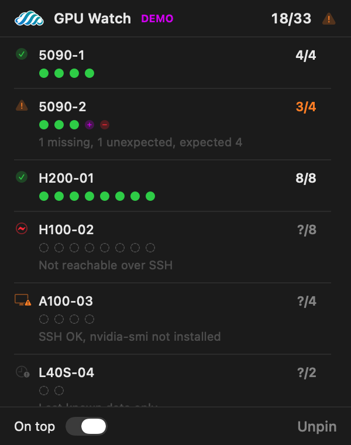
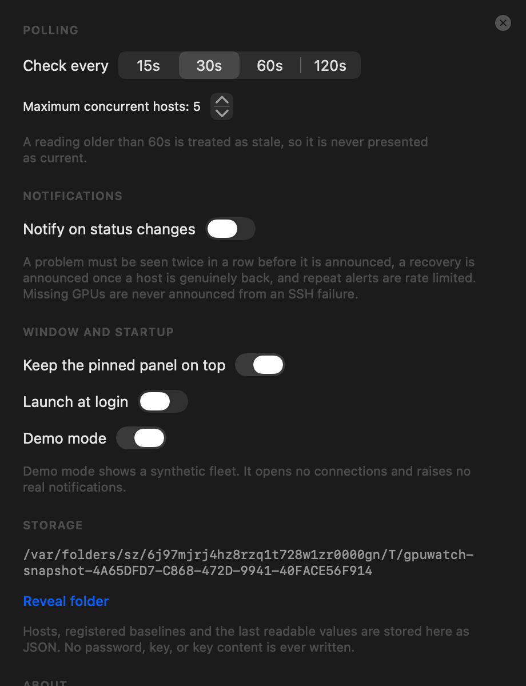

# GPU Watch

**แอป macOS บน Menu Bar สำหรับตรวจสถานะ NVIDIA GPU บน server ระยะไกล ผ่าน SSH — ไม่ต้องติดตั้งอะไรบน server เลย**

[](LICENSE)
[](#สิ่งที่ต้องมี)
[](https://swift.org)
[](#สร้างด้วยของที่มีอยู่แล้ว)

<p align="center">
  
</p>

---

## ปัญหาของ GPU monitor ทั่วไป

มัน**มองโลกในแง่ดีเกินไป**

เวลาที่ SSH หลุด dashboard ทั่วไปจะขึ้น `0/8` สีแดง เวลาที่ driver ไม่ตอบ จะขึ้นรายการว่าง
เวลาที่ยังไม่ได้ poll มา 10 นาที จะโชว์ค่าเก่าที่ค้างอยู่ ทั้งสามกรณีคือจอที่**ดูเหมือนฮาร์ดแวร์พัง
แต่จริง ๆ คือระบบมอนิเตอร์พัง** — และราคาของความสับสนนี้คือการถูกปลุกตอนตีสอง
เพราะการ์ดสี่ใบที่ไม่ได้พังเลย

GPU Watch สร้างขึ้นจากกฎข้อเดียว: **ยอมพูดว่า "ไม่รู้" ดีกว่าโชว์สิ่งที่ยืนยันไม่ได้**

## กฎนี้หน้าตาเป็นอย่างไร

<p align="center">
  
</p>

host ที่ติดต่อไม่ได้จะแสดง `?/8` พร้อมจุดวงกลมเส้นประ — *แปดช่อง ยังไม่ยืนยันสักช่อง* —
ไม่ใช่ `0/8` สีแดงซึ่งอ่านได้ว่า *การ์ดตายแปดใบ* บรรทัดเหตุผลเขียนว่า "Not reachable over SSH"
สองเรื่องนี้เป็นคนละความจริง และแอปก็แยกมันออกจากกัน

| กฎ | ทำไมจึงสำคัญ |
|---|---|
| SSH reachability, GPU query status และความสดของข้อมูล เป็น **สามแกนแยกกัน** | transport สะดุดครั้งเดียวต้องไม่ถูกรายงานเป็น GPU พัง |
| การเชื่อมต่อล้มเหลวทำให้ GPU ทุกตัวเป็น **unknown** — ไม่ใช่ missing และไม่ใช่ healthy | เรามองไม่เห็นการ์ด จึงไม่มีอะไรจะพูดถึงมัน |
| GPU จะถูกเรียกว่า **missing เฉพาะเมื่อผลตรวจที่ครบถ้วนยืนยันว่าไม่มี UUID นั้นจริง** | ห้ามสรุปว่าหายจากผลตรวจที่ไม่ครบ |
| ถ้ายังไม่มี baseline **จะไม่ระบุเลยว่าการ์ดใบไหนหาย** | การ์ดที่ยังไม่เคย fingerprint ระบุตัวตนไม่ได้ |
| ค่าที่ carry มาจากรอบก่อน **ไม่ถูกนับเป็น readable** | ตัวเลขเก่าต้องไม่ทำให้ยอดพอง |
| `N/A` ไม่ถูกแปลงเป็น `0` และ output ว่างหรือ parse ไม่ได้ไม่ถือว่า healthy | "driver ไม่ตอบ" ไม่ใช่ "ค่าเป็นศูนย์" |
| util สูงและ VRAM ใช้มาก **ไม่ถือว่าเครื่องมีปัญหา** | ทำงานหนักไม่ใช่พัง |
| จุดเขียวหมายถึง driver **เห็นและตอบข้อมูลของการ์ดนั้น** — ไม่ได้แปลว่า CUDA, NCCL หรือ vLLM พร้อมใช้ | ขอบเขตของคำกล่าวอ้างระบุใน tooltip ไม่ใช่ให้เดา |

## วิดีโอสาธิต

<p align="center">
  
</p>

41 วินาที เล่าเรื่องเดียว

เริ่มจาก host ที่**การ์ดหายจริง**: `3/4` มีจุดแดงและระบุ UUID ขณะที่ SSH ของเครื่องนั้นขึ้น **Connected** และ GPU query **reported 4** จากนั้น host ที่**ติดต่อไม่ได้**: `?/8` จุดกลวงแปดจุด SSH **Unreachable** และ GPU ทุกตัวติดป้าย *last known* พร้อมบรรทัดกำกับว่า *"The values below are last known, not current."*

missing กับ unknown เป็นคนละความจริง การแยกสองสิ่งนี้ออกจากกันคือหัวใจของการออกแบบทั้งหมด

วิดีโอนี้ render จากหน้าจอจริงที่ขับด้วย demo fleet ที่มีในตัว **ไม่ได้อัดหน้าจอ** จึงไม่มีหน้าต่างอื่นในเครื่องหลุดเข้ามา และทำซ้ำได้:

```bash
./Scripts/make-demo-video.sh     # ได้ dist/demo.mp4 และ dist/demo.gif
```

## ภาพหน้าจอ

| GPU หาย เทียบกับ baseline | Actions ของ host | Panel แบบปักหมุด |
|---|---|---|
|  |  |  |

| host เยอะ | ฟอร์มแก้ไข host | Settings |
|---|---|---|
|  |  |  |

## สิ่งที่ต้องมี

- macOS 14 (Sonoma) ขึ้นไป รองรับทั้ง Apple Silicon และ Intel
- Xcode Command Line Tools — ไม่ต้องมี Xcode project ไม่ต้องมี IDE ไม่ต้องมี signing identity สำหรับ build ในเครื่อง
- ฝั่ง server: SSH และ `nvidia-smi` บน `PATH` ของ user ที่ใช้เชื่อมต่อ

**รองรับเฉพาะ NVIDIA physical GPU** — MIG instance เป็น partition ของการ์ดใบเดียว
จึงจงใจไม่นับเป็นการ์ดเพิ่ม และ AMD ไม่รองรับ โดยแอปจะบอกตรง ๆ แทนที่จะเดา

## ติดตั้ง

### build จากซอร์ส

```bash
git clone https://github.com/siamaicorp/GPUWatch.git
cd GPUWatch
./Scripts/build-app.sh
open dist/GPUWatch.app
```

แอปจะไปอยู่บน Menu Bar เท่านั้น ไม่มีไอคอนใน Dock และไม่มีหน้าต่างเด้งขึ้นมา

ค่าเริ่มต้นเซ็นแบบ **ad-hoc** (`--sign -`) ซึ่งเพียงพอสำหรับ build ในเครื่อง
ไม่มีขั้นตอนไหนไปยุ่งกับ Gatekeeper หรือ security setting ของเครื่องคุณ
ถ้าจะแจกจ่ายให้คนอื่น ให้เซ็นด้วย Developer ID แล้ว notarize:

```bash
SIGN_IDENTITY="Developer ID Application: …" ./Scripts/build-app.sh
xcrun notarytool submit dist/GPUWatch.app.zip --keychain-profile <profile> --wait
xcrun stapler staple dist/GPUWatch.app
```

ใน repo ไม่มีไฟล์ไบนารีสำเร็จรูป — build เองใช้เวลาราวหนึ่งนาที
และแปลว่าคุณรันโค้ดที่อ่านเองได้

## เริ่มใช้งาน

1. เปิดแอป จะเห็น `GPU Watch` บน Menu Bar
2. กด **Add Host** หรือกด **Try Demo** เพื่อดูของจริงกับฝูง host สังเคราะห์ 7 แบบ
   (มี GPU หาย, การ์ดถูกเปลี่ยน, host ที่ติดต่อไม่ได้ และข้อมูลเก่า) ก่อนจะตั้งค่าอะไรเลย
3. กรอก SSH alias หรือ hostname ที่คุณใช้อยู่แล้ว — `~/.ssh/config`, agent และ key ของคุณทำงานให้เองทั้งหมด
4. กด **Test Connection** มันจะรายงานแยกขั้น: *SSH ล้มเหลว* / *SSH ผ่าน แต่ไม่มี nvidia-smi* /
   *SSH ผ่าน แต่ query ล้มเหลว* / *สำเร็จพร้อมจำนวน GPU* — คำว่า "ใช้ไม่ได้" ไม่ใช่คำตอบที่มีประโยชน์
5. เมื่ออ่าน GPU ได้แล้ว เปิด host แล้วกด **Register GPU Baseline**
   เพื่อบันทึกว่าเครื่องนี้ควรมีการ์ดอะไรบ้าง จากนั้นแอปจะบอกได้ว่าตัวไหนหายไป

Demo mode ไม่เปิด connection ใด ๆ ไม่แจ้งเตือนจริง และข้อมูลถูกแยกจาก configuration ของคุณโดยสิ้นเชิง

## ทำงานอย่างไร

GPU Watch เรียก **`ssh` ของระบบ** — `/usr/bin/ssh` ด้วย argument array ไม่ผ่าน shell เลยไม่ว่ากรณีใด
ผลคือ:

- `~/.ssh/config`, `ProxyJump`, `Match`, agent และ certificate ของคุณมีผลทั้งหมด
- เก็บเฉพาะ **path** ของ identity file ไม่เก็บเนื้อหา และไม่เก็บ password
- ไม่แก้ `~/.ssh/config` ไม่ยอมรับ host key ใหม่ และไม่แก้ `known_hosts` ให้
  host key ที่ไม่รู้จักหรือเปลี่ยนไปจะถูกรายงาน เพื่อให้คุณไปยืนยันใน Terminal เอง

ทุก host ได้ remote script ค่าคงที่ตัวเดียว — เป็นค่าคงที่ในซอร์สโค้ด ไม่มีข้อความจากผู้ใช้ถูก interpolate ลงไป:

```sh
nvidia-smi --query-gpu=index,uuid,name,temperature.gpu,utilization.gpu,memory.used,memory.total \
           --format=csv,noheader,nounits
```

script ถูกครอบด้วย marker และปิดท้ายด้วย `exit 0` **เสมอ** รายละเอียดข้อนี้เองที่ทำให้สองแกนแยกออกจากกันได้:
SSH ผ่านแต่ `nvidia-smi` ล้มเหลว เป็นรายงานที่ต่างจากการที่ SSH ล้มเหลวโดยสิ้นเชิง
และแอปแยกออกได้ แทนที่จะยุบรวมเป็น "เครื่องล่ม"

## โมเดลสถานะ

สามแกน แสดงแยกกัน ไม่ยุบรวม:

| แกน | ค่า |
|---|---|
| **SSH transport** | Connected · Unreachable · Auth failed · Host key · Timed out · Cancelled |
| **GPU query** | ok · No nvidia-smi · Query failed · Empty output · Unparsable |
| **ความสดของข้อมูล** | fresh · stale · unknown |

ต่อ host: Checking · Reachable · SSH failed · GPU query failed · Degraded · Stale · Disabled · Unknown

ต่อ GPU — ใช้ทั้งสี **และรูปร่าง** เพราะการแยกแดง/เขียวไม่ช่วยอะไรสำหรับคนที่มองสีไม่ออก:

| | รูปร่าง | ความหมาย |
|---|---|---|
| 🟢 | วงกลมทึบ | driver เห็นการ์ดและตอบค่าหลักครบในรอบล่าสุด |
| 🟡 | สามเหลี่ยม | อ่านได้ แต่มี warning: temp เกินเกณฑ์ที่ตั้ง หรือ metric ที่ driver ไม่รองรับ |
| 🔴 | วงกลมมีขีด | **ยืนยันแล้วว่าหายไป** จากผลตรวจที่ครบถ้วน |
| 🟣 | วงกลมมีเครื่องหมายบวก | พบการ์ดที่ไม่อยู่ใน baseline |
| ⚪ | วงกลมเส้นประ | ยังไม่ยืนยัน: ติดต่อไม่ได้, query ไม่ได้, ยังไม่เคยตรวจ หรือข้อมูลเก่า |

ทุกจุดมี tooltip และ accessibility label ที่ให้ข้อมูลชุดเดียวกับสี

## Load ไม่ใช่สุขภาพ

util อย่างเดียวเป็นสัญญาณที่แย่ การ์ดจะขึ้น 100% ทั้งที่ไม่ได้ทำงานที่มีประโยชน์อะไร และการ์ดที่ย้ายข้อมูลหลายเทระไบต์ผ่านหน่วยความจำอาจขึ้น util แค่ 5% แอปจึงอ่านค่า load เป็นแกนของตัวเอง แยกจากสุขภาพทั้งในเชิงโครงสร้างและในสายตา

```
GPU 1
NVIDIA H100 80GB HBM3
62°C   22%   4.0 GB / 32 GB          ← readability: driver ยังตอบอยู่ไหม
load   ⚡ 412/575 W   🌡 79°C mem   ⇄ 88% mem   ← pressure: ทำงานหนักแค่ไหน
```

บรรทัด `load` เป็นบรรทัดแยกใต้ป้ายของตัวเอง **ไม่ใช่การเปลี่ยนสีจุดสุขภาพ** และ alert ที่มาจาก threshold จะขึ้นต้นด้วย **`load:`** — คนที่อ่าน notification จึงแยกได้ว่าการ์ดกำลังงานหนักหรือการ์ดเสีย โดยไม่ต้องเปิดแอป

อ่าน `power.draw` / `power.limit`, `utilization.memory` (ค่าของ memory controller ซึ่งมักเป็นตัวเลขที่น่าสนใจสำหรับงาน inference และการย้ายข้อมูล) และ `temperature.memory` เฉพาะการ์ดที่ driver รายงาน

> การ์ดหลายรุ่นไม่รายงานอุณหภูมิ HBM เลย — **รวมถึง RTX 5090 ทุกใบ ยืนยันจากเครื่องจริง** field นี้จะคืน `N/A` และแอปจะไม่แสดงอะไรสำหรับค่านั้น แทนที่จะแสดงขีด เพราะขีดที่ขึ้นกับค่าที่ไม่เคยมีอยู่ดูเหมือนอาการเสีย

### Threshold เป็นของคุณ และปิดไว้เป็นค่าเริ่มต้น

ตั้งได้ต่อ host และปิดจนกว่าคุณจะตั้ง: อุณหภูมิ (°C), VRAM ที่ใช้ (%) และสัดส่วนของ power limit (%) เว้นว่างคือไม่มีความเห็น

ค่าเริ่มต้นเป็นว่างเพราะ threshold ที่ไม่ได้ผูกกับสิ่งที่คุณคาดหวังจาก host นั้นคือการเดา: VRAM 80% มีความหมายตรงข้ามกันระหว่างเครื่อง inference ที่ใช้ร่วมกัน กับ workstation ที่ควรว่าง การ์ดที่งานหนักบน host ที่ไม่ได้ตั้ง threshold ใด ๆ จะยัง **เขียว** เพราะมันกำลังทำงาน ไม่ได้ป่วย

### สิ่งที่จงใจไม่ใส่

`clocks_throttle_reasons.active` ไม่ถูก query เพราะมันคืน bitmask ที่ความหมายของแต่ละ bit ไม่นิ่งข้ามเวอร์ชัน driver การถอดความหมายผิดคือการสร้างข้อสรุปที่ยืนยันไม่ได้ ซึ่งเป็นสิ่งที่แอปนี้ตั้งใจหลีกเลี่ยงตั้งแต่แรก ตัวเลขที่คุณเห็นได้และตั้ง threshold ได้ มีค่ามากกว่า reason code ที่คุณตรวจสอบไม่ได้

queue depth, การระบุว่า process ไหนใช้ และคำถามว่า "ควรหยุด job นี้ไหม" ก็ไม่มีเช่นกัน — **ไม่ใช่เพราะมองข้าม** แต่ต้องใช้ DCGM หรือ API ของ scheduler ซึ่งแปลว่าต้องติดตั้งอะไรบน server และมันเปลี่ยนคำถามจาก *"ฮาร์ดแวร์ที่คาดไว้ยังอยู่และตอบไหม"* เป็น *"workload นี้สุขภาพดีไหม"* — คนละผลิตภัณฑ์ คนละคำสัญญา

## Baseline และจำนวนที่คาดหวัง

**UUID คือ identity ส่วน index เป็นแค่การแสดงผล** — index ถูกจัดใหม่หลัง reboot
ดังนั้นมอนิเตอร์ที่นับตาม index จะสร้าง "การ์ดพัง" ปลอมขึ้นมาทุกครั้งที่รีบูต

จำนวน GPU ที่คาดหวังคือ**ค่าของคุณ** และไม่ลดลงตามที่ตรวจพบ:
ถ้าการ์ดพัง baseline ยังเก็บ UUID ไว้ เพื่อให้แอปบอกได้ต่อว่ามันหายไป
การ register baseline จะแสดง UUID ให้ตรวจก่อนยืนยันเสมอ
การเปลี่ยนการ์ดาจะแสดงทั้ง UUID ที่หายไปและ UUID ที่โผล่มา และคุณเป็นคนตัดสินใจรับชุดใหม่

## การตั้งค่า

| ค่า | ค่าเริ่มต้น | ช่วง |
|---|---|---|
| Poll interval | 30 วินาที | 15 / 30 / 60 / 120 วินาที |
| Concurrent checks | 5 hosts | 1–8 |
| Whole-check timeout | 12 วินาที | คงที่ |
| Stale window | `max(2 × interval, 60 วินาที)` | ตาม interval |
| Notifications | ปิด | เปิดเอง |

การ polling ถูกออกแบบให้กด Refresh รัว ๆ แล้วงานไม่ทวีคูณ: หนึ่ง host ตรวจได้ครั้งละหนึ่งงาน,
จำกัด concurrency ระหว่าง host, และมี generation guard เพื่อทิ้งผลที่มาถึงหลังคุณแก้หรือลบ host
แทนที่จะเอาไปใช้กับการตั้งค่าผิดตัว ออกแอปแล้ว ssh ที่ค้างอยู่จะถูกยุติ
**เปิดกี่หน้าต่างก็ไม่เพิ่ม polling loop ที่สอง**

หลัง wake จาก sleep ข้อมูลทั้งหมดจะถูกทำเป็น stale และตรวจใหม่ทันที

## Notifications

ปิดเป็นค่าเริ่มต้น และจะขอสิทธิ์จาก macOS **เมื่อคุณเปิดเองเท่านั้น**

- ปัญหาต้องถูกเห็น **2 รอบติดกัน** ก่อนแจ้ง — poll ล้มครั้งเดียวส่วนใหญ่คือ hiccup
  และแอปที่ร้องหมาป่าบ่อย ๆ จะถูกเพิกเฉย
- แจ้ง recovery ด้วย และผ่านการยืนยันแบบเดียวกัน host ที่กระพริบไปมาจึงไม่สลับ banner ไปมา
- จำกัดอัตราการแจ้งซ้ำ
- **GPU หายจาก transport failure จะไม่ถูกแจ้งเลย** บังคับที่ระดับโครงสร้าง:
  transport ที่ล้มเหลวให้ `missing == 0` เสมอ จึงสร้างข้อความนั้นไม่ได้ตั้งแต่ต้น

## ความเป็นส่วนตัว

- ไม่มี telemetry ไม่มี analytics ไม่มีการเรียกออกเครือข่ายเลยนอกจาก `ssh` ไปยัง host ที่คุณตั้งค่าไว้
- ไม่เขียน password, key หรือเนื้อหา key ลงดิสก์
- ทุกอย่างอยู่ที่ `~/Library/Application Support/GPUWatch/` (โหมด `0700`) เป็นไฟล์ JSON สามไฟล์ที่มี schema version:

```
config.json        host และ settings
baseline.json      GPU baseline ที่คุณยืนยันแล้ว
last-known.json    ค่าที่อ่านได้ล่าสุด สำหรับแสดง "last known" หลังเปิดแอปใหม่
```

เขียนแบบ atomic ทุกครั้ง **ไฟล์ที่อ่านไม่ได้จะไม่ถูกเขียนทับ** — จะถูกเก็บไว้ใต้ชื่อที่มี timestamp
และรายงานความล้มเหลวพร้อมปุ่มเปิดโฟลเดอร์ ส่วนไฟล์ที่เขียนด้วยเวอร์ชันใหม่กว่าจะถูกปฏิเสธพร้อมคำอธิบาย
แทนที่จะอ่านผิด ๆ

## สร้างด้วยของที่มีอยู่แล้ว

Swift กับ SwiftUI บวก AppKit บางส่วนสำหรับหน้าต่าง **ไม่มี dependency จากภายนอกเลยแม้แต่ตัวเดียว** —
ไม่มี Electron ไม่มี web view ไม่มี backend ไม่มี Docker

```
GPUWatch.app/Contents/MacOS/GPUWatch    2.2 MB
GPUWatch.app (ทั้ง bundle)              2.7 MB
```

## โครงสร้างโค้ด

```
Sources/
├── GPUWatchCore/        ไม่มี UI เลย — test ได้โดยไม่ต้องมี SSH
│   ├── Models/          HostConfig, GPUSample, Baseline, Status, HostReport, PollSettings
│   ├── SSH/             SSHTarget (validation), SSHProcessRunner, RemoteProbe,
│   │                    HostProbeRunner, SSHFailureClassifier, ConnectionTester
│   ├── Parsing/         CSVLine, GPUFieldValue, NVIDIAQueryParser
│   ├── Evaluation/      GPUStateEvaluator — นโยบายทั้งหมดอยู่ที่นี่
│   ├── Polling/         Clock, AppModel (single source of truth)
│   ├── Store/           ConfigurationStore
│   ├── Notifications/   NotificationService, UserNotificationDeliverer
│   └── Demo/            DemoFixtures
├── GPUWatchUI/          SwiftUI + AppKit เป็น library เพื่อให้ harness render view จริงได้
├── GPUWatch/            entry point
└── GPUWatchSnapshot/    harness สำหรับ visual QA
```

parser และ state evaluator ไม่ผูกกับ SSH และ runner กับ clock เป็น protocol
พฤติกรรมที่น่าสนใจจึง test ได้โดยไม่ต้องมี server

### เรื่อง `MenuBarExtra`

ตอนแรกสร้างด้วย `MenuBarExtra` ของ SwiftUI แล้วเปลี่ยนมาถือ `NSStatusItem` เอง
เพราะ `MenuBarExtra` ไม่เปิดช่องให้ตรวจสอบหรือควบคุมอะไรได้เลย:
ไม่รู้ว่าติดตั้งสำเร็จไหม เปิด popover ด้วยโปรแกรมไม่ได้ และไม่มี handle ให้รายงานสถานะ
เมื่อมีอะไรมาซ่อนมันไว้ — ระหว่างพัฒนาก็เจอเคสที่ item ไม่ปรากฏโดยหาสาเหตุไม่ได้
การถือ `NSStatusItem` เองทำให้ `--diagnose` แยก "ไม่ได้ติดตั้ง" ออกจาก "ติดตั้งแล้วแต่ถูกซ่อน" ได้
และ `--show-popover` เปิด popover ตัวจริงมาตรวจได้

ที่เกี่ยวข้องกัน: บน Mac ที่มีหลายจอ menu bar item จะไปอยู่บน**จอที่เป็นเจ้าของ menu bar ขณะนั้น**
ไม่จำเป็นต้องเป็นจอหลัก

## การทดสอบ

```bash
swift test                    # 148 tests
./Scripts/verify-ui.sh        # render ทุกหน้าจอ + รายงานตำแหน่ง menu bar item
```

ครอบคลุม: CSV ที่มี quoted fields · `N/A`, unsupported, malformed และ output ว่าง ·
identity ที่รอดจากการสลับ index · baseline GPU ที่หายไป · UUID ใหม่ที่โผล่มา · expected count ไม่ตรง ·
**SSH ล้มไม่กลายเป็น GPU หาย** · partial result ไม่กลายเป็น missing · timeout และ cancellation ·
ข้อมูลเก่า · ผลที่มาถึงหลังแก้หรือลบ host · notification debounce, cooldown และ recovery ·
ไฟล์ config เสีย · host ที่โหลดจากดิสก์ต้องตรวจจบจริง · หน้าต่างต้องไม่ถูก rebuild ระหว่างใช้งาน ·
action ทุกตัวของ host ต้องไปถึง model

### Visual QA

`Sources/GPUWatchSnapshot` render **view ตัวจริง** ลง `dist/screenshots/` เพื่อให้ตรวจ UI จากภาพได้
แทนที่จะต้องไล่คลิกบน menu bar ตัว harness วาด view hierarchy ลง bitmap เอง
แทนการใช้ `CGWindowListCreateImage` ซึ่ง deprecated ต้องขอสิทธิ์ screen recording
และคืนภาพเปล่าเป็นระยะ

แอปยังมีโหมดสำหรับ troubleshoot สามแบบ:

```bash
GPUWatch --diagnose                            # สภาพแวดล้อม + menu bar item อยู่ตรงไหน
GPUWatch --check user@host --expected 8        # ตรวจ host จริงหนึ่งเครื่องผ่าน pipeline ของแอปเอง
GPUWatch --show-popover                        # เปิด popover ตัวจริงค้างไว้
```

## ข้อจำกัด

เขียนไว้ตรง ๆ เพราะมอนิเตอร์ที่ขายตัวเองเกินจริงคือปัญหาที่โปรเจกต์นี้ตั้งใจแก้

- **ไม่รองรับ process และ MIG** อ่านเฉพาะชุด field คงที่: ไม่มี `--query-compute-apps`, NVLink หรือ ECC
  และไม่มีประวัติหรือกราฟ
- **AMD ไม่รองรับโดยเจตนา**
- **remote login shell ต้องเป็น POSIX** (`sh`, `bash`, `dash`, `zsh`) ถ้าเป็น `csh`/`tcsh`
  marker จะไม่กลับมา และแอปจะรายงานเป็นปัญหา SSH ที่ระบุไม่ได้ แทนที่จะแกล้งทำเป็นสำเร็จ
- **Notifications ยังไม่ถูกยืนยันแบบ end-to-end บนเครื่องจริง** logic มี unit test ครบ
  แต่ยังไม่เคยเห็น permission prompt และ banner ที่ส่งจริง
- ทดสอบบน **macOS 27.2.1 Apple Silicon เท่านั้น** ยังไม่ได้ลอง macOS 14–26 หรือ Intel
- **ยังไม่ทดสอบกับ host ที่ GPU พังจริง, host key เปลี่ยน, หรือการ์ดหลายรุ่นผสมกัน**
  การยืนยันกับของจริงทำกับ host ที่เข้าถึงได้และการ์ดที่ปกติ
- หน้า Settings ยังไม่แสดงว่า permission ของ notification ถูกปฏิเสธหรือยัง จนกว่าจะลองเปิด
- การ scroll และการกดสวิตช์ในหน้าต่างจริง **ยืนยันด้วย test ไม่ใช่ด้วยภาพ**:
  `screencapture` บนเครื่องพัฒนาเริ่มคืนภาพดำ การตรวจหน้าต่างรอบสุดท้ายจึงอิงจาก test

## สัญญาอนุญาต

GPL-3.0-or-later ดู [LICENSE](LICENSE)

Copyright © 2026 SIAM.AI Corporation

เลือก GPL อย่างตั้งใจ: ใครก็ใช้ ศึกษา และดัดแปลงได้ แต่ถ้าแจกจ่ายเวอร์ชันที่ดัดแปลงแล้ว
ต้องเปิดซอร์สด้วย — เครื่องมือที่บอกความจริงเกี่ยวกับฮาร์ดแวร์ของคุณ ควรตรวจสอบได้เสมอ

**ชื่อและโลโก้ SIAM.AI เป็นเครื่องหมายการค้าของ SIAM.AI Corporation และไม่อยู่ภายใต้สัญญาอนุญาต GPL**
ถ้าคุณ fork ไปและแจกจ่าย build ของตัวเอง กรุณาเปลี่ยนแบรนด์ — สัญญาอนุญาตของโค้ดไม่ครอบคลุมถึงเครื่องหมายการค้า
ไฟล์ศิลป์อยู่ที่ `Sources/GPUWatchUI/Resources/` และ `Packaging/Brand/`

---

[Read in English →](README.md)
