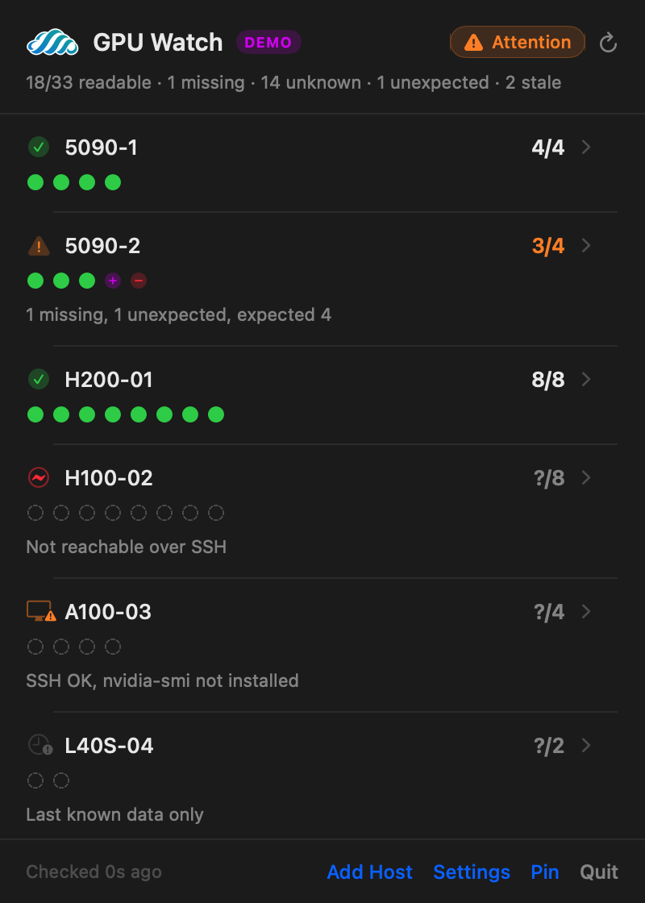
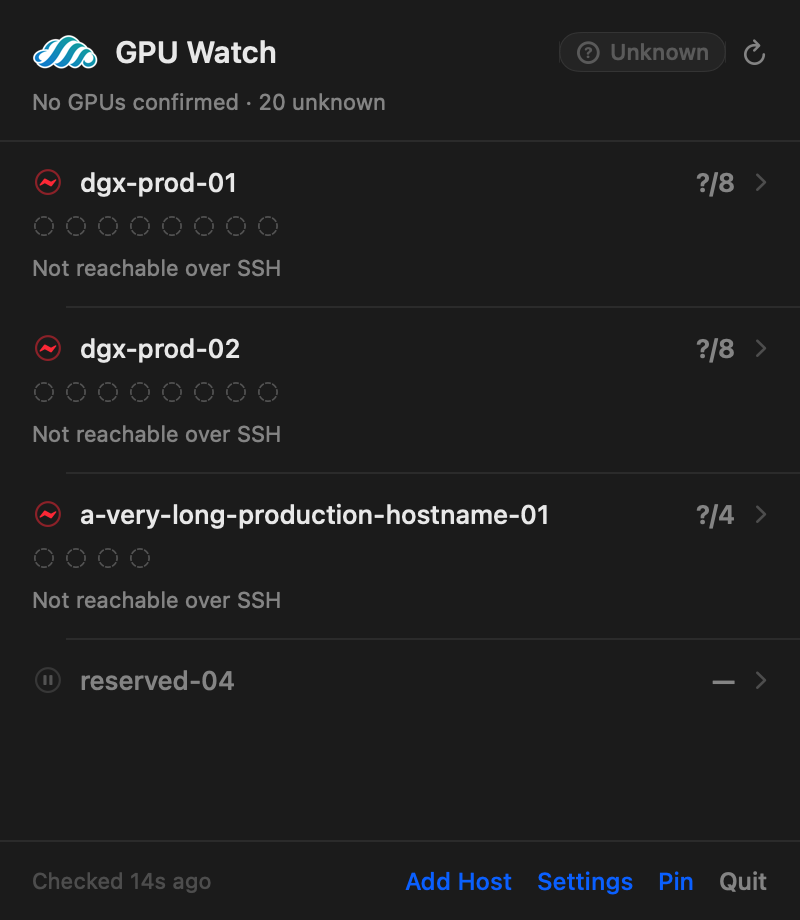
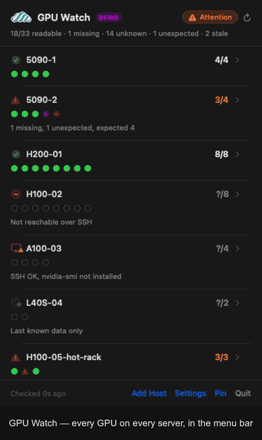
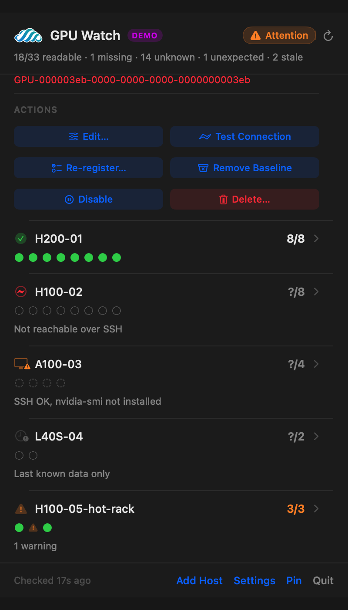
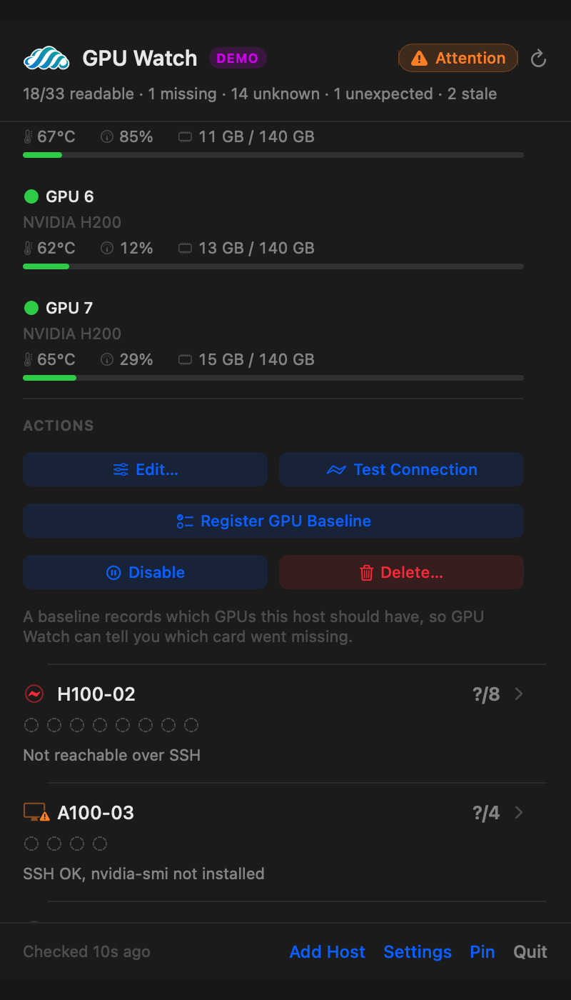
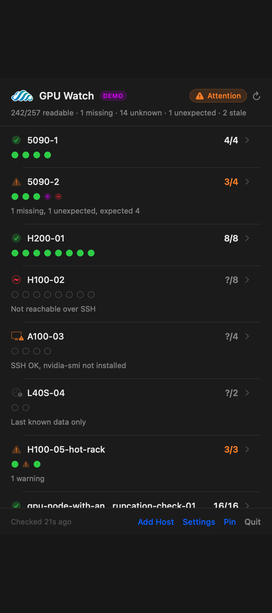
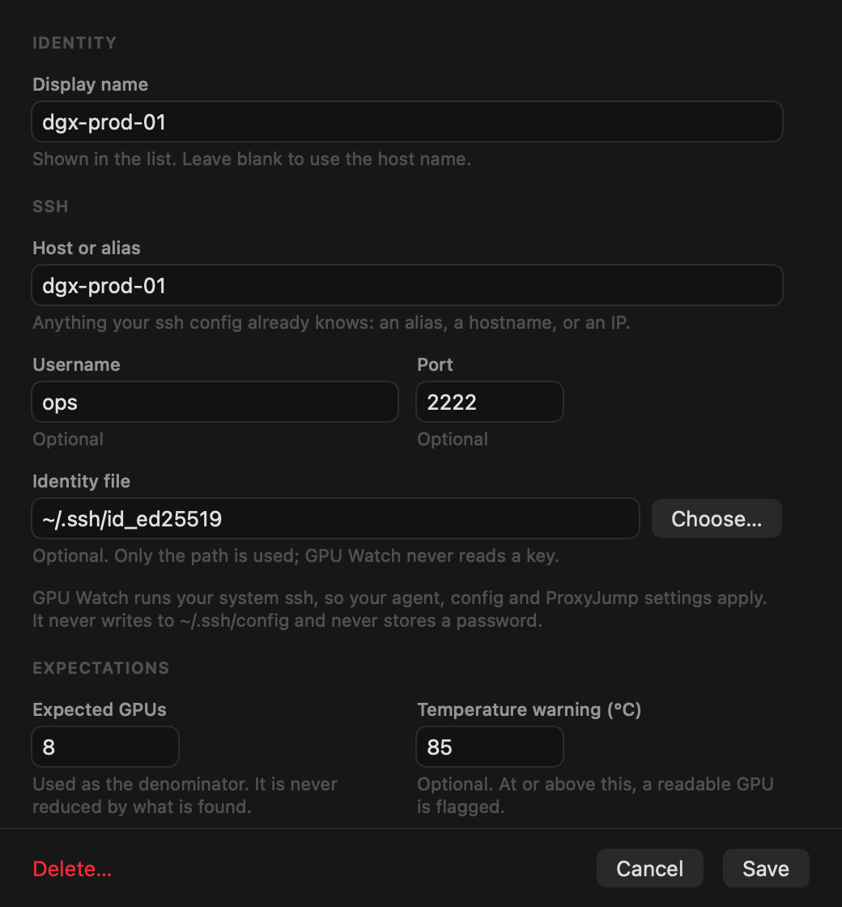

# SIAM.AI GPU Watch

แอปบนเมนูบาร์ macOS สำหรับตรวจ GPU ทั้ง NVIDIA และ AMD บนเซิร์ฟเวอร์หลายเครื่องผ่าน SSH ดูจำนวนการ์ดที่อ่านข้อมูลได้ อุณหภูมิ การใช้งาน GPU และหน่วยความจำได้ในหน้าต่างเดียว

ใช้ SSH และเครื่องมือ GPU ที่มีอยู่บนเซิร์ฟเวอร์ — `nvidia-smi` สำหรับ NVIDIA, `rocm-smi` สำหรับ AMD — ไม่ต้องติดตั้ง agent เพิ่ม

[](LICENSE)
[](#สิ่งที่ต้องมี)
[](https://swift.org)

<p align="center">
  
</p>

## สิ่งที่ทำได้

- ตรวจหลาย host ตามรอบเวลาที่ตั้งไว้ และสั่ง Refresh ได้
- แสดงสถานะของ GPU แต่ละใบ พร้อมอุณหภูมิ การใช้งาน และ VRAM
- แสดงกำลังไฟและข้อมูลหน่วยความจำเพิ่มเติมตามที่ driver รองรับ
- บันทึก UUID ของการ์ดเป็น baseline เพื่อใช้ตรวจหาการ์ดที่หายไปหรือถูกเปลี่ยน
- ปักหมุดหน้าต่างไว้บนหน้าจอ และเปิดการแจ้งเตือนได้
- ทดลองหน้าตาด้วย **Try Demo** โดยไม่ต้องเชื่อมต่อเซิร์ฟเวอร์

## สิ่งที่ต้องมี

- macOS 14 (Sonoma) ขึ้นไป โดยโครงการกำหนดเป้าหมายรองรับ Apple Silicon และ Intel ดูขอบเขตการทดสอบในหัวข้อข้อจำกัด
- Xcode Command Line Tools สำหรับ build แอปจากซอร์ส
- เซิร์ฟเวอร์ที่เข้า SSH ได้ และเรียกเครื่องมือของผู้ผลิตนั้นได้จาก `PATH` ของผู้ใช้ที่เชื่อมต่อ — `nvidia-smi` สำหรับ NVIDIA, `rocm-smi` สำหรับ AMD
- Login shell ฝั่งเซิร์ฟเวอร์ที่รองรับคำสั่งแบบ POSIX เช่น `sh`, `bash`, `dash` หรือ `zsh`

นับเฉพาะการ์ดจริง NVIDIA MIG instance เป็น partition ของการ์ดใบเดียว จึงไม่นับเป็นการ์ดเพิ่ม ส่วนโฮสต์ที่ไม่มีเครื่องมือทั้งสองตัว
จะถูกรายงานว่า "ไม่พบเครื่องมือ GPU" ซึ่งเป็นข้อความเกี่ยวกับซอฟต์แวร์ของเครื่องนั้น ไม่ใช่เกี่ยวกับการ์ดของมัน

### โฮสต์ถูกอ่านด้วยผู้ผลิตไหน

ค่าเริ่มต้นคือตรวจจับเอง: ใช้ `nvidia-smi` เมื่อมันตอบกลับมาเป็นแถวข้อมูลจริง ไม่เช่นนั้นจึงใช้ ROCm ลำดับนี้สำคัญ
เพราะเครื่องที่ย้ายจาก NVIDIA มา AMD มักยังมี `nvidia-smi` ติดอยู่และตอบกลับด้วย error และการรายงาน error นั้นจริงแต่ไม่มีประโยชน์
นอกจากนี้ยังปักหมุดโฮสต์เป็น NVIDIA หรือ AMD ได้ในหน้าแก้ไขโฮสต์ สำหรับเครื่องที่ยังเหลือเครื่องมือของผู้ผลิตเดิมอยู่บน `PATH`

ทั้งสองเส้นทางรายงานชุดค่าอ่านเดียวกัน threshold, baseline และ notification จึงไม่ต้องรู้ว่าโฮสต์เป็นผู้ผลิตไหน
จุดที่หน่วยต่างกันแปลงครั้งเดียวใน parser: ROCm รายงาน VRAM เป็น bytes และถูกแปลงเป็น MiB ให้ตรงกับ nvidia-smi

มีค่าหนึ่งที่ไม่ถูกยุบรวมแบบนั้น และแอปไม่ทำเป็นว่าเหมือนกัน คือ **อุณหภูมิ** เซนเซอร์ edge ของ ROCm ตรงกับที่ nvidia-smi เรียก `temperature.gpu` จึงถูกใช้ก่อน
แต่การ์ด Instinct ไม่มีเซนเซอร์ edge เลย มีแต่ junction ("hotspot") กับ memory จึงใช้ junction แทน แล้วแสดงคำว่า `junction` กำกับทุกที่ที่มีตัวเลข
รวมถึงในข้อความเตือน threshold ด้วย

## ติดตั้ง

### ดาวน์โหลด

ไฟล์เวอร์ชันล่าสุดแนบไว้ที่ [Releases](https://github.com/siamaicorp/GPUWatch/releases) เป็น universal binary ที่ใช้ได้ทั้ง Apple Silicon และ Intel

ไฟล์นี้**เซ็นแบบ ad-hoc และไม่ได้ทำ notarization** macOS จะติด quarantine ให้ และ Gatekeeper จะปฏิเสธไม่ให้เปิด จนกว่าจะลบ flag ออก:

```bash
xattr -d com.apple.quarantine /Applications/GPUWatch.app
```

### build จากซอร์ส

ไม่ยุ่งกับ Gatekeeper เลย และได้รันโค้ดที่อ่านได้เอง โครงการเป็น Swift package เดียว ไม่มี dependency ภายนอก

```bash
git clone https://github.com/siamaicorp/GPUWatch.git
cd GPUWatch
./Scripts/build-app.sh
open dist/GPUWatch.app
```

เมื่อเปิดแอปจะมีรายการบนเมนูบาร์ ไม่มีไอคอนใน Dock หากต้องการ universal binary ให้ build ด้วย `UNIVERSAL=1 ./Scripts/build-app.sh`

Build ในเครื่องใช้การเซ็นแบบ ad-hoc (`--sign -`) หากต้องการแจกจ่ายแอป ให้เซ็นด้วย Developer ID และทำ notarization:

```bash
SIGN_IDENTITY="Developer ID Application: …" ./Scripts/build-app.sh
xcrun notarytool submit dist/GPUWatch.app.zip --keychain-profile <profile> --wait
xcrun stapler staple dist/GPUWatch.app
```

## เริ่มใช้งาน

1. คลิก **GPU Watch** บนเมนูบาร์ แล้วเลือก **Add Host**
2. ใส่ SSH alias หรือ hostname ที่ใช้งานอยู่ แอปใช้ค่าใน `~/.ssh/config` รวมถึง SSH agent และ key ของระบบ
3. กด **Test Connection** เพื่อตรวจการเชื่อมต่อและการเรียกเครื่องมือ GPU หากไม่สำเร็จ แอปจะแสดงว่าติดขัดในขั้นตอนไหน:
   *SSH ล้มเหลว* / *SSH ผ่าน แต่ไม่พบเครื่องมือ GPU* / *SSH ผ่าน แต่ query ล้มเหลว* / *สำเร็จพร้อมจำนวน GPU*
4. เมื่ออ่านข้อมูลได้แล้ว เลือก **Register GPU Baseline** ตรวจ UUID และยืนยันรายการการ์ดของเครื่องนั้น
5. ตั้งรอบการตรวจและการแจ้งเตือนตามต้องการ

หากต้องการลองก่อน ให้เลือก **Try Demo** ข้อมูลจำลองมีทั้งกรณีการ์ดหาย การ์ดถูกเปลี่ยน ติดต่อ host ไม่ได้ และข้อมูลเก่า โหมดนี้ไม่เชื่อมต่อเซิร์ฟเวอร์หรือส่งการแจ้งเตือนจริง และแยกข้อมูลจากการตั้งค่าของผู้ใช้

## อ่านสถานะอย่างไร

แอปแสดงผลการเชื่อมต่อ SSH ผลการอ่าน GPU และอายุของข้อมูลแยกกัน ตัวอย่างเช่น host ที่คาดว่ามี 8 ใบแต่ติดต่อไม่ได้ จะแสดง `?/8` เพราะยังตรวจจำนวนปัจจุบันไม่ได้

<p align="center">
  
</p>

| สัญลักษณ์ | ความหมาย |
|---|---|
| วงกลมสีเขียว | Driver อ่านข้อมูลหลักของการ์ดได้ในรอบล่าสุด |
| สามเหลี่ยมสีเหลือง | อ่านข้อมูลได้ แต่มีคำเตือน เช่น อุณหภูมิเกินเกณฑ์ หรือบางค่าไม่รองรับ |
| วงกลมสีแดงมีขีด | ผลตรวจที่ครบถ้วนไม่พบ UUID ที่บันทึกไว้ใน baseline |
| วงกลมสีม่วงมีเครื่องหมายบวก | พบ UUID ที่ยังไม่อยู่ใน baseline |
| วงกลมเส้นประ | ยังยืนยันสถานะไม่ได้ เช่น ติดต่อไม่ได้ อ่านข้อมูลไม่สำเร็จ หรือข้อมูลเก่า |

เลื่อนเมาส์เหนือสัญลักษณ์เพื่ออ่านรายละเอียด แต่ละสถานะมีรูปร่างและ accessibility label ประกอบด้วย

**จุดสีเขียวยืนยันได้เพียงว่า driver อ่านข้อมูลการ์ดได้** ไม่ได้ตรวจว่า CUDA, ROCm, NCCL, vLLM หรืองานที่รันอยู่พร้อมใช้งาน

ค่าจากรอบก่อนจะแสดงเป็น **last known** และไม่นับเป็นผลตรวจปัจจุบัน ส่วน `N/A` จะไม่ถูกแปลงเป็นศูนย์

### Baseline

Baseline คือรายการ UUID ของ GPU ที่ผู้ใช้ยืนยันไว้สำหรับ host นั้น แอปใช้ UUID ติดตามการ์ด เพราะหมายเลข index อาจเปลี่ยนหลังรีบูต

หากผลตรวจไม่ครบหรือ SSH ล้มเหลว แอปจะไม่สรุปว่าการ์ดหาย หากยังไม่ได้บันทึก baseline ก็จะยังระบุไม่ได้ว่าการ์ดใบใดหายไป

จำนวน GPU ที่คาดหวังจะไม่ลดลงตามจำนวนที่ตรวจพบ เมื่อเปลี่ยนการ์ด แอปจะแสดง UUID เดิมและ UUID ใหม่ให้ตรวจสอบก่อนยืนยัน baseline ชุดใหม่

### การใช้งานและเกณฑ์แจ้งเตือน

บรรทัด **load** แสดงข้อมูลการใช้งานแยกจากสถานะการอ่าน GPU ได้แก่:

- กำลังไฟที่ใช้และขีดจำกัดกำลังไฟ (`power.draw`, `power.limit` บน NVIDIA ส่วน ROCm รายงานเป็น socket power กับค่าสูงสุดของมัน)
- การใช้งาน memory controller (`utilization.memory` บน NVIDIA ส่วน ROCm คือ `GPU Memory Allocated`)
- อุณหภูมิหน่วยความจำ (`temperature.memory` บน NVIDIA ส่วน ROCm คือ `Temperature (Sensor memory)`) เมื่อ driver รายงานค่านี้

ข้อมูลที่อ่านได้ขึ้นอยู่กับรุ่นการ์ดและ driver หากไม่มีค่าอุณหภูมิหน่วยความจำ แอปจะไม่แสดงค่านั้น

ตั้งเกณฑ์ได้แยกต่อ host สำหรับอุณหภูมิ ปริมาณ VRAM ที่ใช้ และกำลังไฟเป็นสัดส่วนของ power limit ค่าเริ่มต้นเว้นว่างไว้ ช่องที่เว้นว่างจะไม่มีเกณฑ์แจ้งเตือน ข้อความแจ้งเตือนกลุ่มนี้ขึ้นต้นด้วย `load:`

การใช้งาน GPU หรือ VRAM สูงเพียงอย่างเดียวไม่ได้ยืนยันว่าการ์ดเสีย ต้องพิจารณาร่วมกับลักษณะงานของ host นั้น

## ภาพสาธิต

<p align="center">
  
</p>

ภาพเคลื่อนไหวสร้างจากหน้าจอของแอปโดยใช้ข้อมูลจำลอง ไม่ใช่ผลทดสอบกับการ์ดที่เสียจริง สร้างใหม่ได้ด้วย:

```bash
./Scripts/make-demo-video.sh
# ผลลัพธ์: dist/demo.mp4 และ dist/demo.gif
```

| GPU ที่ไม่พบใน baseline | เมนูของ host | หน้าต่างปักหมุด |
|---|---|---|
|  |  |  |

| หลาย host | เพิ่มหรือแก้ไข host | การตั้งค่า |
|---|---|---|
|  |  |  |

## การตั้งค่า

| รายการ | ค่าเริ่มต้น | ตัวเลือก |
|---|---|---|
| รอบการตรวจ | 30 วินาที | 15 / 30 / 60 / 120 วินาที |
| จำนวน host ที่ตรวจพร้อมกัน | 5 | 1–8 |
| เวลาสูงสุดต่อการตรวจหนึ่งรอบ | 12 วินาที | คงที่ |
| เวลาที่ถือว่าข้อมูลเก่า | `max(2 × รอบการตรวจ, 60 วินาที)` | เปลี่ยนตามรอบการตรวจ |
| การแจ้งเตือน | ปิด | ผู้ใช้เปิดเอง |

แต่ละ host ตรวจได้ครั้งละหนึ่งงาน การกด Refresh ซ้ำหรือเปิดหลายหน้าต่างจะไม่เพิ่มงานตรวจซ้อนกัน ผลที่กลับมาหลังแก้ไขหรือลบ host จะถูกทิ้ง และเมื่อออกจากแอปจะยุติ SSH ที่ยังทำงานอยู่

หลังเครื่องตื่นจาก sleep แอปจะทำเครื่องหมายข้อมูลเดิมว่าเก่า แล้วเริ่มตรวจใหม่

### การแจ้งเตือน

แอปขอสิทธิ์แจ้งเตือนจาก macOS เมื่อผู้ใช้เปิดใช้งาน โดยต้องพบปัญหาสองรอบติดต่อกันก่อนแจ้ง การกลับสู่สถานะปกติใช้การยืนยันแบบเดียวกัน และมีการจำกัดการแจ้งซ้ำ

การเชื่อมต่อ SSH ล้มเหลวจะไม่ทำให้เกิดข้อความแจ้งว่า GPU หาย

## การเชื่อมต่อและข้อมูลที่จัดเก็บ

แอปเรียก `/usr/bin/ssh` โดยส่งอาร์กิวเมนต์ตรง รองรับค่าใน `~/.ssh/config` รวมถึง `ProxyJump`, `Match`, SSH agent และ certificate ส่วนคำสั่งตรวจ GPU ทำงานผ่าน login shell ฝั่งเซิร์ฟเวอร์

แอปไม่แก้ `~/.ssh/config` หรือ `known_hosts` และไม่ยอมรับ host key ใหม่ให้อัตโนมัติ หากพบ key ที่ไม่รู้จักหรือเปลี่ยนไป ผู้ใช้ต้องตรวจสอบและยืนยันผ่าน Terminal ก่อน

คำสั่งที่ใช้ตรวจ GPU มีสองคำสั่งตายตัว — เป็นค่าคงที่ในซอร์สโค้ด ไม่มีข้อความจากผู้ใช้ถูก interpolate ลงไป:

```sh
# NVIDIA
nvidia-smi --query-gpu=index,uuid,name,temperature.gpu,utilization.gpu,memory.used,memory.total,power.draw,power.limit,temperature.memory,utilization.memory --format=csv,noheader,nounits

# AMD (ROCm)
rocm-smi --showproductname --showuniqueid --showtemp --showuse --showmemuse \
         --showmeminfo vram --showpower --showmaxpower --csv
```

Remote script ครอบผลลัพธ์ ผู้ผลิตที่ตอบกลับ และรหัสตอบกลับของคำสั่งไว้ในชุดข้อความที่มี marker เพื่อให้แอปแยกการอ่าน GPU ล้มเหลวออกจากการเชื่อมต่อ SSH ล้มเหลวได้ และปิดท้ายด้วย `exit 0` เสมอ ซึ่งเป็นสิ่งที่ทำให้การแยกนั้นเป็นไปได้

CSV ของ ROCm ถูกอ่าน **ตามชื่อคอลัมน์ ไม่ใช่ตามตำแหน่ง** เพราะ rocm-smi สร้าง header จาก union ของ key ที่มีอยู่บนการ์ดแต่ละใบ เครื่องที่การ์ดรายงานเมตริกไม่เหมือนกันจึงได้ลำดับคอลัมน์ต่างจากเครื่องที่การ์ดเหมือนกัน การอ่านตามตำแหน่งจะผูกตัวเลขผิดเข้ากับเมตริกผิดโดยไม่บอก

ไม่มี telemetry หรือ analytics การเชื่อมต่อเครือข่ายของแอปใช้ SSH ไปยัง host ที่ตั้งค่าไว้ เก็บเพียง path ของ identity file ไม่เก็บรหัสผ่านหรือเนื้อหา private key

ข้อมูลอยู่ใน `~/Library/Application Support/GPUWatch/` โดยโฟลเดอร์ใช้สิทธิ์ `0700`:

| ไฟล์ | ข้อมูล |
|---|---|
| `config.json` | Host และการตั้งค่า |
| `baseline.json` | รายการ GPU ที่ยืนยันแล้ว |
| `last-known.json` | ค่าที่อ่านได้ล่าสุด สำหรับแสดงหลังเปิดแอปใหม่ |

ไฟล์มี schema version และเขียนแบบ atomic หากอ่านไฟล์ไม่ได้ แอปจะเก็บไฟล์เดิมไว้ด้วยชื่อที่มี timestamp และแจ้งข้อผิดพลาด หาก schema ใหม่กว่าเวอร์ชันที่แอปรองรับ แอปจะไม่อ่านไฟล์นั้น

## สำหรับผู้พัฒนา

เขียนด้วย Swift, SwiftUI และ AppKit ไม่มี dependency จากภายนอก

| ส่วน | หน้าที่ |
|---|---|
| `Sources/GPUWatchCore/` | SSH, การอ่านผล, ประเมินสถานะ, polling, จัดเก็บข้อมูล และแจ้งเตือน |
| `Sources/GPUWatchUI/` | หน้าจอ SwiftUI และหน้าต่าง AppKit |
| `Sources/GPUWatch/` | จุดเริ่มต้นของแอป |
| `Sources/GPUWatchSnapshot/` | สร้างภาพหน้าจอสำหรับตรวจ UI |

เมนูบาร์ใช้ `NSStatusItem` เพื่อให้ตรวจสถานะและสั่งเปิด popover ได้ บนเครื่องที่มีหลายจอ ตำแหน่งไอคอนขึ้นอยู่กับจอที่แสดงเมนูบาร์ขณะนั้น

### ทดสอบและตรวจปัญหา

```bash
swift test                    # 203 tests
./Scripts/verify-ui.sh        # render ทุกหน้าจอ + รายงานตำแหน่ง menu bar item
```

ชุดทดสอบครอบคลุมการอ่าน CSV, ข้อมูลที่ไม่สมบูรณ์, UUID และ baseline, SSH ล้มเหลว, timeout, ข้อมูลเก่า, การแจ้งเตือน และไฟล์ตั้งค่าที่อ่านไม่ได้ โดย parser และตัวประเมินสถานะทดสอบได้โดยไม่ต้องเชื่อมต่อเซิร์ฟเวอร์

สำหรับ ROCm ครอบคลุมเรื่องลำดับคอลัมน์ที่ไม่เปลี่ยนผลลัพธ์, VRAM ที่แปลงจาก bytes, GUID ที่เป็นศูนย์ และบรรทัดเตือนที่ rocm-smi พิมพ์มาก่อน header
fixture หนึ่งชุดคือแถวข้อมูลเต็มที่เก็บมาตรง ๆ จากเครื่อง 8× Instinct MI300X จริง ซึ่งเป็นชุดที่เผยว่าการ์ดเหล่านั้นไม่มีเซนเซอร์ edge เลย

Snapshot harness สร้างภาพจาก view ของแอปลงใน `dist/screenshots/` ภาพเหล่านี้ใช้ตรวจหน้าตา แต่ไม่ทดแทนการทดสอบการกดใช้งานจริง

คำสั่งสำหรับตรวจปัญหา:

```bash
GPUWatch --diagnose
GPUWatch --check user@host --expected 8
GPUWatch --show-popover
```

## ข้อจำกัดและขอบเขตการทดสอบ

- ไม่แสดง process ที่ใช้ GPU, MIG instance, NVLink, ECC, queue depth, ประวัติ หรือกราฟ
- ไม่อ่าน `clocks_throttle_reasons.active` และไม่ประเมินว่าควรหยุดงานหรือปรับ scheduler อย่างไร
- ROCm อ่าน identity ได้แคบกว่า nvidia-smi การ์ด AMD รายงานเป็น GUID 64 บิต ไม่ใช่สตริง `GPU-…` และการ์ด consumer บางรุ่นรายงาน `0` ทุกใบ GUID ที่เป็นศูนย์ถูกถือว่าไม่มี identity การ์ดเหล่านั้นจึงมองเห็นได้แต่ติดตามข้าม reboot ไม่ได้
- อุณหภูมิของ AMD อาจมาจากคนละเซนเซอร์ การ์ด Instinct ไม่มีเซนเซอร์ edge เลย จึงใช้ค่า junction ("hotspot") แทน และแสดงคำว่า `junction` กำกับทุกที่ที่มีตัวเลข ค่า junction สูงกว่าสำหรับการ์ดใบเดียวกัน threshold จึงเป็นตัวเลขเดียวที่ใช้กับเซนเซอร์ที่การ์ดนั้นมีจริง
- ROCm 7 เปลี่ยนจาก `rocm-smi` ไปใช้ `amd-smi` ปัจจุบันรองรับเฉพาะ `rocm-smi`
- Login shell แบบ `csh` หรือ `tcsh` ไม่รองรับ script ที่ใช้ตรวจ และอาจถูกรายงานเป็นข้อผิดพลาด SSH ที่ระบุสาเหตุไม่ได้
- การแจ้งเตือนมี unit test แต่ยังไม่ได้ยืนยัน permission prompt และ banner แบบ end-to-end บนเครื่องจริง หน้า Settings ยังไม่แสดงสถานะการปฏิเสธสิทธิ์จนกว่าจะลองเปิดแจ้งเตือน
- บันทึกการทดสอบเดิมระบุ macOS 27.2.1 บน Apple Silicon ยังไม่มีผลยืนยันบน macOS 14–26 หรือ Intel
- ยังไม่มีผลทดสอบกับ GPU ที่เสียจริง, host key ที่เปลี่ยน หรือ host ที่มีการ์ดหลายรุ่นผสมกัน การทดสอบเชื่อมต่อจริงใช้ host ที่เข้าถึงได้และการ์ดที่ทำงานปกติ
- การรองรับ AMD ยืนยันกับเครื่อง 8× Instinct MI300X บน ROCm 7.8.0 จริง: อ่านได้ทั้ง 8 ใบ ไม่มีคำเตือน และตรวจจับผู้ผลิตได้เอง parser มีเทสต์กับ output ที่เก็บมาจากเครื่องนั้นตรง ๆ
- การตรวจการเลื่อนหน้าจอและสวิตช์ในรอบก่อนอิงชุดทดสอบ เนื่องจากเครื่องมือจับภาพหน้าจอบนเครื่องพัฒนาคืนภาพดำ

## สัญญาอนุญาต

GPL-3.0-or-later ดูเงื่อนไขใน [LICENSE](LICENSE)

Copyright © 2026 SIAM.AI Corporation

ชื่อและโลโก้ SIAM.AI เป็นเครื่องหมายการค้าของ SIAM.AI Corporation และไม่อยู่ภายใต้สัญญาอนุญาต GPL หากนำไปแจกจ่ายเป็นแอปของตนเอง กรุณาเปลี่ยนชื่อและโลโก้ ไฟล์อยู่ใน `Sources/GPUWatchUI/Resources/` และ `Packaging/Brand/`

[Read in English](README.md)
